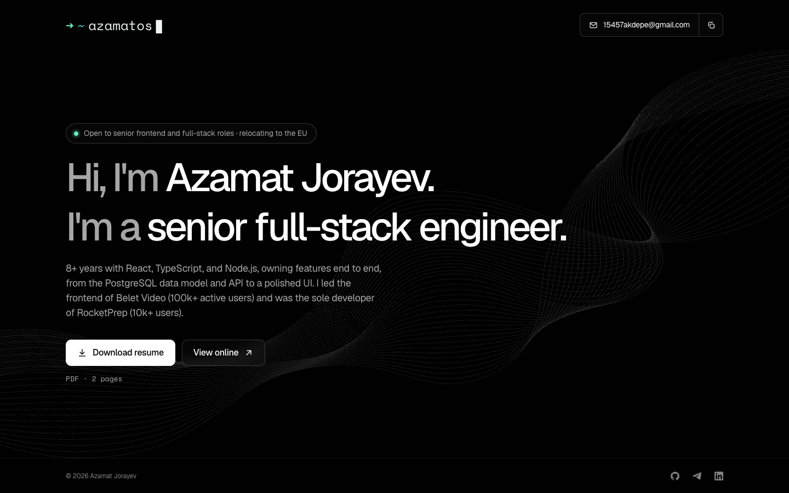

# azamatos — Personal Portfolio

[](https://github.com/azamatos/portfolio/actions/workflows/ci.yml)

Personal site of Azamat Jorayev, senior full-stack engineer. Static HTML, readable without JavaScript, 100 in every Lighthouse category.

🌐 Live: [`azamatos.com`](https://azamatos.com)



---

## Performance

Lighthouse, mobile emulation, production build:

| | Performance | Accessibility | Best practices | SEO | FCP | LCP | Blocking time | Page weight |
| --- | :-: | :-: | :-: | :-: | :-: | :-: | :-: | :-: |
| Before (Lit + Vite) | 98 | 100 | 100 | 100 | 1.1 s | 2.0 s | 150 ms | 361 KiB |
| Now (Astro) | **100** | **100** | **100** | **100** | **0.8 s** | **1.7 s** | **0 ms** | **132 KiB** |

What changed: every word is in the HTML instead of being rendered by JavaScript, the only JavaScript is the typing title and the copy-email button (inlined, about 2 KB together, no framework), the hero wave is a cached SVG file instead of 42 KB of markup inside the JS bundle, and fonts are preloaded with size-matched fallbacks.

CI fails if accessibility, best practices or SEO drop below 100 (`lighthouserc.json`). The 404 page skips the SEO check, since it is kept out of search on purpose.

---

## Tech

- [Astro](https://astro.build) 7, static output, no client framework
- TypeScript (strict), ESLint, Prettier
- Self-hosted Geist and Space Mono through the Astro Fonts API
- GitHub Actions: type check, lint, build, Lighthouse CI; a weekly refresh of the project data (Playwright, sharp, ffmpeg, Cloudflare R2)

---

## Run locally

```sh
pnpm install
pnpm dev       # http://localhost:4000
pnpm build     # static site in dist/
pnpm preview   # serve dist/

pnpm check     # type check (astro check)
pnpm lint
```

## Update content

- **Text and links:** `src/site.ts`. The page, meta tags, structured data and `/llms.txt` all read from it.
- **Resume:** replace `public/Azamat_Jorayev_Resume.pdf` with the new full-stack PDF (same file name).
- **Share image:** replace `src/assets/og-image.png` (1200×630). Its URL changes with the file, so LinkedIn and Telegram fetch the new one when you refresh the link preview.

## Project data

Each project is two files: `src/content/projects/<id>.yaml`, written by hand (the text, the links, and where every number and screenshot comes from), and `src/data/collected/<id>.json`, written only by the refresh command (each number with its date and source, and the screenshots on `media.azamatos.com`). The build reads both and fetches nothing.

```sh
pnpm data:refresh               # every project
pnpm data:refresh visaproof     # one project
pnpm data:refresh --no-shots    # numbers and links only
pnpm data:refresh --dry-run     # read and capture, write and upload nothing
```

It needs Playwright's Chromium (`pnpm exec playwright install chromium`) and ffmpeg. Uploads need `R2_ACCOUNT_ID`, `R2_ACCESS_KEY_ID` and `R2_SECRET_ACCESS_KEY` in `.env`; without them the shots go to `.cache/refresh/` and the JSON keeps its old ones. A number that can't be read keeps its last value, goes under `problems` and makes the command fail. GitHub runs it every Monday (and from **Run workflow** in Actions), then commits the JSON if it changed.

**Add a project:** copy one of the YAML files to `src/content/projects/<id>.yaml`, edit it, run `pnpm data:refresh <id>` and commit both files.

## Structure

```text
src/
  site.ts                    copy, links, resume path
  layouts/BaseLayout.astro   <head> (SEO, Open Graph, JSON-LD, fonts), header and footer
  components/                Header, Logo, EmailButton, Hero, ResumeActions, Footer
  pages/index.astro          home page
  pages/404.astro            not-found page
  pages/llms.txt.ts          plain-text profile for AI assistants (/llms.txt)
  styles/global.css          tokens and reset
  assets/                    fonts, share image
  content/projects/          one YAML file per project
  data/collected/            what the refresh command collected, one JSON file per project
  lib/projects/              schema, values and media for the project pages
scripts/refresh/             pnpm data:refresh
public/                      resume PDF, icons, hero.svg, _redirects (old resume links)
```

New pages go in `src/pages/` and get the header, footer and meta tags from `BaseLayout`. The sitemap updates itself.

---

## Author

**Azamat Jorayev**

- Website: [`azamatos.com`](https://azamatos.com)
- GitHub: [`azamatos`](https://github.com/azamatos)
- Telegram: [`eldzhernone`](https://t.me/eldzhernone)
- LinkedIn: [`igwt`](https://linkedin.com/in/igwt)

---

## License

MIT
